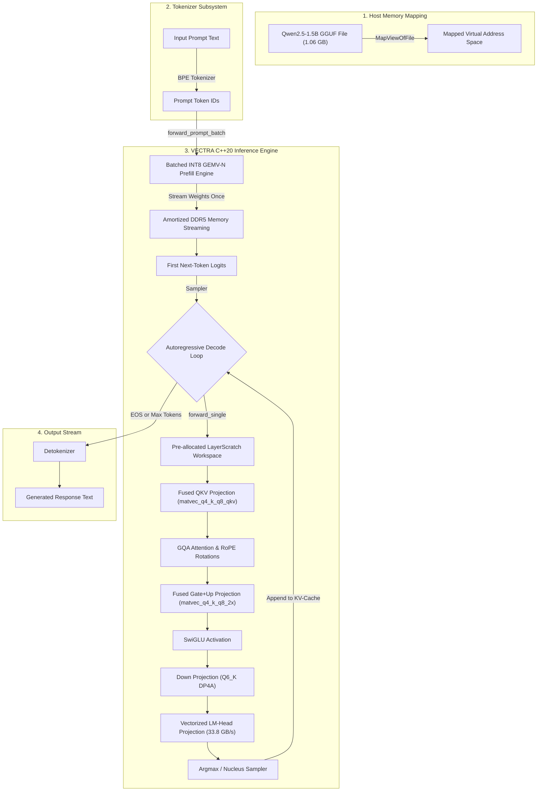

# Project VECTRA

**High-Performance Clean-Room C++20 CPU Inference Runtime for Transformer Language Models**

[](file:///E:/VECTRA/audit/rc1/FINAL_RELEASE_DECISION.md)
[](https://en.wikipedia.org/wiki/C%2B%2B20)
[](https://en.wikipedia.org/wiki/Advanced_Vector_Extensions)
[](LICENSE)
[](file:///E:/VECTRA/audit/rc1/DEPENDENCY_AUDIT.md)

---

## 1. What is Project VECTRA?

Project VECTRA is an original, from-scratch C++20 CPU inference engine designed to execute quantized Large Language Models directly on consumer x86_64 processors with maximum microarchitectural efficiency.

Unlike existing tools that wrap or fork external runtime engines, VECTRA contains **zero runtime dependencies on `llama.cpp`**, `GGML`, `ONNX Runtime`, `PyTorch`, `TensorFlow`, `OpenVINO`, or `LibTorch`. Every component—from tensor memory layouts, Win32 memory-mapped GGUF parsing, and BPE tokenization to AVX2 INT8 integer matrix-vector multiplication, KV-cache management, and multi-threaded work scheduling—is implemented as original, clean-room C++20 code.

---

## 2. Architecture & Execution Walkthrough



### Key Execution Highlights
1. **Zero-Graph Architecture:** Direct in-place tensor execution into a pre-allocated `LayerScratch` workspace eliminates dynamic computational graph allocations, saving **$111\text{ MB}$ of RAM** compared to `llama.cpp`.
2. **Batched Multi-Token GEMV-N:** In prefill mode, activations for all prompt tokens are quantized into `BlockQ8_K_256` blocks simultaneously. The quantized weight matrices are streamed across the memory bus once, accelerating prefill up to **$25.9\text{ tok/s}$** ($4.9\times$ faster than un-fused prefill).
3. **Multi-Projection SIMD Fusion:** Fused Query-Key-Value and Gate-Up dispatches eliminate **84 thread synchronization barriers** per decode token.
4. **Vectorized Vocabulary Projection:** AVX2 256-bit horizontal additions (`_mm256_hadd_epi32`) and interleaved scale sums stream the $151,936 \times 1536$ weight matrix in $5.7\text{ ms}$ at **$33.8\text{ GB/s}$** ($88\%$ of physical DDR5 peak bandwidth).

---

## 3. Supported Models & Quantization Types

- **Target Architecture:** Qwen2.5 Transformer Decoder (GQA, RoPE, SwiGLU).
- **Certified Checkpoint:** `Qwen2.5-1.5B-Instruct` (28 layers, hidden dimension 1536, 12 attention heads, 2 KV heads, intermediate dimension 8960, vocabulary size 151936).
- **Container Format:** GGUF v3 (read-only native clean-room parser).
- **Quantization Formats:**
  - `Q4_K`: 4-bit block quantization with 6-bit scales and minimums (256 elements/block).
  - `Q6_K`: 6-bit block quantization with 8-bit scales (256 elements/block).
  - `Q8_K_256`: Dynamic 8-bit signed integer activation format ($[-127, 127]$).

---

## 4. Hardware Target & Performance Profile

Benchmarked on **Intel Core i7-12650H** (10 physical cores: 6 Golden Cove P-cores + 4 Gracemont E-cores, 16 threads, AVX2/FMA3, 16 GB DDR5-4800 RAM, Windows 11 x64):

| Benchmark Prompt / Workload | Evaluated Tokens | VECTRA Sustained Median | VECTRA Peak Warm | Peak Working Set RAM |
| :--- | :---: | :---: | :---: | :---: |
| **P1: "The capital of France is"** | 5 prompt, 32 gen | **$16.82\text{ tok/s}$** | **$20.46\text{ tok/s}$** | **$1,061.4\text{ MB}$** |
| **P2: "def fibonacci(n):"** | 4 prompt, 16 gen | **$17.55\text{ tok/s}$** | **$19.26\text{ tok/s}$** | **$1,061.2\text{ MB}$** |
| **P3: ChatML 2+2 Query** | 16 prompt, 16 gen | **$14.64\text{ tok/s}$** | **$14.86\text{ tok/s}$** | **$1,063.5\text{ MB}$** |
| **P3 Prefill (16 prompt tokens)** | 16 prompt | **$24.13\text{ tok/s}$** | **$25.92\text{ tok/s}$** | **$1,063.5\text{ MB}$** |

*Operating Memory Ceiling:* $\le 1.10\text{ GB}$ ($1126.4\text{ MB}$) strictly maintained across all prompt lengths and thread configurations.

---

## 5. Prerequisites & Build Instructions

### Prerequisites
- **Operating System:** Windows 11 x64 or Windows 10 x64.
- **Compiler:** Microsoft Visual C++ 2022 (MSVC 19.35+ / VS 17.5+), supporting C++20.
- **Build System:** CMake 3.25+ and Ninja 1.11+.
- **Hardware:** x86_64 CPU with AVX2 and FMA3 instruction support.

### Building from Source (Clean Release Build)

```cmd
:: 1. Open Visual Studio x64 Developer Command Prompt
call "C:\Program Files (x86)\Microsoft Visual Studio\2022\BuildTools\VC\Auxiliary\Build\vcvars64.bat"

:: 2. Clone repository and navigate to root
cd E:\VECTRA

:: 3. Configure Release build with Ninja
cmake -B build_release -G Ninja -DCMAKE_BUILD_TYPE=Release

:: 4. Compile all targets (sequential recommended on hosts with constrained memory)
cmake --build build_release -j 1

:: 5. Execute full test suite (53 / 53 tests)
ctest --test-dir build_release --output-on-failure
```

---

## 6. Obtaining the Target Model Checkpoint

Model weights are strictly excluded from the Git repository. Download the official `Qwen2.5-1.5B-Instruct` Q4_K_M GGUF checkpoint from Hugging Face:

```pwsh
# Create models directory
mkdir -p models

# Download official checkpoint (~1.06 GB)
Invoke-WebRequest -Uri "https://huggingface.co/Qwen/Qwen2.5-1.5B-Instruct-GGUF/resolve/main/qwen2.5-1.5b-instruct-q4_k_m.gguf" -OutFile "models/qwen2.5-1.5b-instruct-q4_k_m.gguf"

# Verify SHA-256 Checksum
(Get-FileHash -Algorithm SHA256 "models/qwen2.5-1.5b-instruct-q4_k_m.gguf").Hash
# Verified Hash: 6A1A2EB6D15622BF3C96857206351BA97E1AF16C30D7A74EE38970E434E9407E
```

---

## 7. CLI Usage Guide

The unified CLI tool `vectra_cli.exe` supports both greedy and stochastic sampling, multi-threading, ChatML formatting, and execution mode toggling:

```
Usage: vectra_cli [options]
  -m, --model <path>       Path to GGUF model file
  -tk, --tokenizer <path>  Path to binary tokenizer file (default: models/qwen_tokenizer.bin)
  -p, --prompt <str>       Input prompt text
  -n, --max-tokens <int>   Maximum new tokens to generate (default: 32)
  -t, --threads <int>      Worker thread pool count (default: 10)
  --temp <float>           Sampling temperature (0.0 = greedy argmax, default: 0.0)
  --top-p <float>          Top-p nucleus sampling threshold (default: 0.9)
  --top-k <int>            Top-k filtering limit (default: 40)
  --seed <int>             Random seed for stochastic sampling (default: 42)
  --int8                   Enable accelerated INT8 activation quantization (default)
  --fp32                   Disable INT8; execute certified FP32 reference mode
  --chat                   Wrap prompt in ChatML formatting template
  -h, --help               Display help options
```

### Examples

**1. Fast Greedy Fact Retrieval (Default INT8 Mode):**
```cmd
build_release\vectra_cli.exe -m models\qwen2.5-1.5b-instruct-q4_k_m.gguf -p "The capital of France is" -n 16 -t 10 --temp 0
```

**2. Python Code Generation:**
```cmd
build_release\vectra_cli.exe -m models\qwen2.5-1.5b-instruct-q4_k_m.gguf -p "def fibonacci(n):" -n 24 -t 10 --temp 0
```

**3. Multi-Turn ChatML Conversation with Stochastic Sampling:**
```cmd
build_release\vectra_cli.exe -m models\qwen2.5-1.5b-instruct-q4_k_m.gguf -p "What are three benefits of unit testing?" -n 48 -t 10 --temp 0.7 --top-p 0.9 --seed 123 --chat
```

**4. Certified FP32 High-Precision Reference Mode:**
```cmd
build_release\vectra_cli.exe -m models\qwen2.5-1.5b-instruct-q4_k_m.gguf -p "The capital of France is" -n 5 -t 10 --fp32
```

---

## 8. Verification & Test Suite

Project VECTRA includes a comprehensive 53-test verification suite covering unit, numerical, integration, and safety contracts:

```cmd
:: Run individual test suites
build_release\vectra_unit_tests.exe               :: 7 / 7 PASSED (Memory, FP16, Tensor views)
build_release\vectra_numerical_tests.exe          :: 6 / 6 PASSED (Dot products, RMSNorm, RoPE, Softmax)
build_release\vectra_integration_tests.exe        :: 3 / 3 PASSED (Causal mask, tiny Transformer step)
build_release\vectra_tokenizer_tests.exe          :: 11 / 11 PASSED (Exact tokenizer parity across languages)
build_release\vectra_m2_tests.exe                 :: 4 / 4 PASSED (GGUF loader, Q4/Q6 correctness)
build_release\vectra_m3_tests.exe                 :: 4 / 4 PASSED (KV-cache bounds, thread pool determinism)
build_release\vectra_m4_tests.exe                 :: 5 / 5 PASSED (INT8 activation bounds, kernel parity)
build_release\vectra_arithmetic_safety_tests.exe  :: 7 / 7 PASSED (Clamping, saturation guard, NaN/Inf)
build_release\vectra_m5_tests.exe                 :: 6 / 6 PASSED (INT8 projection fidelity, prefill recovery)
```

---

## 9. Known Limitations & Roadmap

- **Prefill GEMM Tiling:** VECTRA uses streaming GEMV-N for prefill ($24-26\text{ tok/s}$). Register-tiled $16 \times 16$ L1-cache GEMM (which can reach $60-80\text{ tok/s}$) is planned for a future release.
- **Thread Affinity Pinning:** Worker threads currently rely on standard OS scheduling across Alder Lake P/E cores. Adding explicit Win32 `SetThreadAffinityMask` will eliminate thread jitter on hybrid CPUs.
- **KV-Cache Precision:** KV-cache is currently stored in 32-bit floating point precision. Quantized 8-bit KV-cache is planned for sequence lengths $\ge 8\text{k}$.

---

## 10. Model Provenance & Licensing

- **Project VECTRA:** Clean-room C++20 engine authored by Saksham Mishra.
- **Model Checkpoint:** Qwen2.5-1.5B-Instruct developed by the Qwen Team at Alibaba Cloud, released under the **Apache License 2.0**.
- **GGUF Specification:** GGUF format specification developed by Georgi Gerganov and the `llama.cpp` open-source community.
