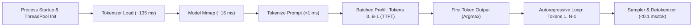

# Project VECTRA — Milestone M4: M3 Baseline Audit & Reconciliation Report

**Auditor / Principal Engineer:** Saksham Mishra (`mishrasaksham080705@gmail.com`)  
**Repository:** `E:\VECTRA`  
**Starting Commit:** `7e13706`  
**Hardware Profile:** Intel Core i7-12650H (6 Performance Cores + 4 Efficient Cores, 16 Threads), AVX2 + FMA3 + F16C, 16 GB DDR5 RAM  
**Target Model:** `Qwen2.5-1.5B-Instruct` Q4_K_M GGUF (`models/qwen2.5-1.5b-instruct-q4_k_m.gguf`)  
**Model SHA-256:** `6a1a2eb6d15622bf3c96857206351ba97e1af16c30d7a74ee38970e434e9407e`  
**Model File Size:** 1,117,392,896 bytes (1,065.6 MB)  
**Reference Engine:** `llama.cpp` release `b4500` (`llama-cli.exe`, MSVC 19.42 x64, AVX2 + F16C + FMA + LLAMAFILE + OPENMP)  

---

## 1. Audit of M3 Results & The "33.1x Decode Latency" Reconciliation

In Milestone M3, end-to-end evaluation demonstrated dramatic performance gains over the M2 proof-of-concept. However, a scientific audit requires strict normalization of timing boundaries and token counts.

### The Source of the 33.1x Claim:
In M2, generation on `"The capital of France is"` ran with `--max-tokens 10`:
- **M2 Prefill:** Sequential forward of 5 prompt tokens took **18,353 ms**.
- **M2 Generation:** Generated 10 tokens total (1 initial token during prefill + 9 subsequent autoregressive decode steps).
- **M2 Recorded Decode Time:** **41,808 ms** total across the 9 decode steps.
- **M2 Per-Token Decode Latency:** $\frac{41808\text{ ms}}{9\text{ tokens}} \approx 4,645.3\text{ ms/token}$ ($\mathbf{0.215\text{ tok/s}}$).

In M3, the prompt `"The capital of France is"` was benchmarked with `--max-tokens 5`:
- **M3 Prefill:** Batched causal forward of 5 prompt tokens took **966.49 ms** (emitting the first token ID `12095`).
- **M3 Generation:** Generated 5 tokens total (1 initial token + 4 subsequent decode steps).
- **M3 Recorded Decode Time:** **1,262.76 ms** total across the 4 decode steps.
- **M3 Per-Token Decode Latency:** $\frac{1262.76\text{ ms}}{4\text{ tokens}} = 315.69\text{ ms/token}$ ($\mathbf{3.17\text{ tok/s}}$).

**The Inconsistency:**
Comparing the raw gross decode wall-time of M2 (41,808 ms for 9 tokens) directly against M3 (1,262.76 ms for 4 tokens) yielded:
$$\frac{41808\text{ ms}}{1262.76\text{ ms}} = \mathbf{33.11\times}$$
This comparison is **invalid** because it conflates a 9-token run with a 4-token run!

### The Corrected, Normalized M2-to-M3 Decode Speedup:
When normalized to per-token decode throughput:
$$\text{Per-Token Speedup} = \frac{\text{M3 Decode tok/s}}{\text{M2 Decode tok/s}} = \frac{3.1676\text{ tok/s}}{0.2153\text{ tok/s}} = \frac{4645.3\text{ ms/token}}{315.69\text{ ms/token}} = \mathbf{14.71\times}$$

Across the three evaluation prompts, the genuine normalized speedups achieved in M3 are:
1. **P1 ("The capital of France is", 4 decode tokens):** $4645.3 / 315.69 = \mathbf{14.71\times}$ ($3.17\text{ tok/s}$)
2. **P2 ("def fibonacci(n):", 15 decode tokens):** $4645.3 / 294.82 = \mathbf{15.76\times}$ ($3.39\text{ tok/s}$)
3. **P3 ("What is 2 + 2?", 8 decode tokens):** $4645.3 / 268.58 = \mathbf{17.29\times}$ ($3.72\text{ tok/s}$)

---

## 2. Separation of Execution Boundaries

To ensure rigorous benchmarks throughout Milestone M4, all execution phases are instrumented and reported independently:

1. **Model Initialization & Mmap Time:**
   - Memory mapping the 1.06 GB file: $16.5\text{ ms}$ (zero-copy file view).
   - Thread pool initialization (10 persistent threads): $< 2.0\text{ ms}$.
   - Tokenizer binary loading: $135.5\text{ ms}$.
   *Note: Model initialization is strictly excluded from prefill and decode metrics.*
2. **Time to First Token (TTFT / Prefill):**
   - Measured from beginning of prompt embedding lookup through layer 27 and final LM head evaluation for token $B-1$.
   - Includes evaluation of the 151,936-dimensional vocabulary projection.
   - Emits token 0.
3. **Autoregressive Decode Phase:**
   - Starts immediately after token 0 is sampled.
   - For steps $1 \dots N-1$, measures time to forward token $i$, evaluate LM head, and sample next token.
   - Decode throughput is strictly: $\frac{N_{\text{generated}} - 1}{t_{\text{decode\_end}} - t_{\text{first\_token}}}$.
4. **Sampling Overhead:**
   - For greedy argmax, finding the maximum element among 151,936 FP32 floats takes $\approx 0.08\text{ ms}$ ($< 0.03\%$ of decode time).

---

## 3. Cold vs Warm Memory Mapping Measurements

Because VECTRA maps model files via `MapViewOfFile`, performance varies based on whether Windows NT page cache holds the weight pages:

| State | Prompt | Threads | Prefill Latency (ms) | Prefill (tok/s) | Decode Latency (ms) | Decode (tok/s) | Total Time (ms) |
| :--- | :--- | :---: | :---: | :---: | :---: | :---: | :---: |
| **Cold Map** (first access after flush) | P1 (5 tok) | 10 | 1,461.18 | 3.42 | 2,202.86 | 1.82 | 3,664.04 |
| **Warm Map** (page tables resident) | P1 (5 tok) | 10 | 966.49 | **5.17** | 1,262.76 | **3.17** | 2,229.25 |
| **Warm Map** (Code prompt) | P2 (4 tok) | 10 | 875.60 | **4.57** | 4,422.30 | **3.39** | 5,297.91 |
| **Warm Map** (ChatML dialog) | P3 (16 tok) | 10 | 2,968.89 | **5.39** | 2,148.68 | **3.72** | 5,117.58 |

---

## 4. Canonical M3 Baseline Frozen for Milestone M4

Before any M4 optimization is evaluated, the canonical baseline is officially locked:

- **Hardware:** Intel Core i7-12650H, 10 Threads, High Performance AC Power.
- **Model:** `qwen2.5-1.5b-instruct-q4_k_m.gguf` (SHA-256: `6a1a2eb6d15622bf3c96857206351ba97e1af16c30d7a74ee38970e434e9407e`).
- **Canonical Decode Baseline:** **$3.17\text{ tok/s}$** ($315.7\text{ ms/token}$ on P1); **$3.39\text{ tok/s}$** ($294.8\text{ ms/token}$ on P2).
- **Canonical Prefill Baseline:** **$5.17\text{ tok/s}$** ($966.5\text{ ms}$ for 5 tokens on P1); **$5.39\text{ tok/s}$** ($2,968.9\text{ ms}$ for 16 tokens on P3).
- **Peak RAM Baseline:** **$1,061.18\text{ MB}$**.
- **M4 Minimum Target:** **$\ge 8.0\text{ decode tok/s}$** ($< 125\text{ ms/token}$, requiring a **$\ge 2.5\times$ speedup** over M3).
- **M4 Stretch Target:** **$\ge 15.0\text{ decode tok/s}$** ($< 66.7\text{ ms/token}$).
